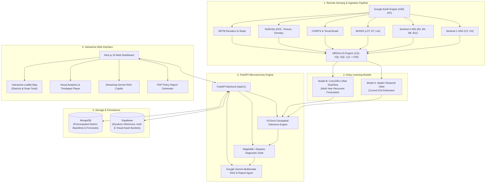

# STAFDRS: Spatio-Temporal AI Framework for Sindh Desertification Risk Prediction and Forecasting

[](https://www.python.org/downloads/)
[](https://nextjs.org/)
[](https://fastapi.tiangolo.com/)
[](https://pytorch.org/)
[](https://opensource.org/licenses/MIT)

An end-to-end, multi-modal geospatial intelligence framework combining satellite remote sensing (Google Earth Engine), deep learning (Spatio-Temporal UNet & ConvGRU), dual database architecture (MongoDB & Supabase), and generative AI (Google Gemini Multimodal RAG) to assess, predict, and forecast desertification risk across the province of Sindh, Pakistan.

---

## 📌 Executive Summary & Motivation

The province of **Sindh, Pakistan** faces severe ecological degradation driven by arid and hyper-arid climates, erratic monsoon rainfall, extreme summer temperatures, overgrazing, deforestation, and unsustainable irrigation practices. Traditional desertification monitoring systems rely heavily on manual field surveys or static, single-snapshot remote sensing indices that fail to capture the complex, non-linear spatio-temporal dynamics of land degradation.

**STAFDRS** addresses these limitations by establishing:
1. **Multi-Source Satellite Integration (38 Channels):** Harmonizing Sentinel-1 SAR, Sentinel-2 Multispectral, MODIS thermal/vegetation, CHIRPS precipitation, TerraClimate, SoilGrids, SRTM topography, and socioeconomic indicators.
2. **Standardized Sensitivity Benchmarking:** Adapting the Mediterranean Desertification and Land Use (**MEDALUS**) framework into continuous quantitative sub-indices: Climate Quality Index (CQI), Vegetation Quality Index (VQI), Soil Quality Index (SQI), and Land Management Quality Index (LQI) to formulate the target **Desertification Sensitivity Index (DSI)**.
3. **Dual Deep Learning Architecture:**
   - **Model A (UNet Estimator):** High-resolution spatial mapping of current Desertification Sensitivity ($[B, 33, 64, 64] \to [B, 1, 64, 64]$) from multi-sensor observations.
   - **Model B (ConvGRU-UNet Forecaster):** Autoregressive recurrent sequence-to-sequence model capable of forecasting multi-year quarterly spatial trajectories of DSI ($2026 \to 2030$).
4. **Interactive Geospatial Dashboard:** A modern, production-grade Next.js 16 and Leaflet web interface enabling environmental scientists, policy makers, and administrative authorities to analyze precomputed district histories or run on-demand real-time inferences on arbitrary user-drawn bounding boxes.
5. **Generative Multimodal Copilot & Policy Reporting:** Automated, evidence-grounded policy advisory generation and streaming conversational RAG powered by Google Gemini 1.5/2.0.

---

## 🏛️ System Architecture



---

## 📁 Repository Structure

```text
sindh-desertification-risk-prediction-and-forecasting/
├── desertification-dashboard/      # Next.js 16 frontend geospatial web application
│   ├── app/                        # App router (layout, globals, interactive page)
│   ├── components/                 # MapWidget (Leaflet + Draw), SearchBar
│   ├── public/                     # Static assets, GeoJSON district boundaries
│   ├── package.json                # Frontend dependencies & scripts
│   └── README.md                   # Comprehensive frontend documentation
├── desertification_api/            # FastAPI microservice backend
│   ├── app/
│   │   ├── api/                    # Route handlers & Pydantic request/response schemas
│   │   ├── core/                   # System configuration, paths, environment bindings
│   │   ├── models/                 # PyTorch neural network architectures (UNet, ConvGRU)
│   │   ├── services/               # GEE ingestion, PyTorch inference, visual generation,
│   │   │                           # MongoDB, Supabase, RAG & Report services
│   │   └── main.py                 # FastAPI application factory & lifespan events
│   ├── testing/                    # Test suites and validation scripts
│   ├── pyproject.toml              # UV / Pip build configuration
│   └── README.md                   # Comprehensive backend documentation
├── experimentation/                # Research notebooks, dataset building, training & eval
│   ├── model_a/                    # UNet experiments, training, metrics, ablation studies
│   │   ├── metrics/                # Stratified evaluation charts & training curves
│   │   ├── notebooks/              # Training & inference Jupyter notebooks
│   │   └── tests/                  # Perturbation tests & spatial residual maps
│   ├── model_b/                    # ConvGRU-UNet Seq2Seq experiments, rollout tests
│   │   ├── metrics/                # Validation metrics, temporal error drift curves
│   │   ├── notebooks/              # Training, inference, and multi-year rollout notebooks
│   │   └── tests/                  # Predictive uncertainty maps & seasonal analyses
│   ├── creating_kaggle_dataset.ipynb
│   ├── spatio_temporal_sindh_desertification.ipynb
│   ├── initial_data_collection_and_processing.md # Detailed remote sensing documentation
│   ├── problems.txt                # Channel quality validation & missing data logs
│   └── README.md                   # Research & experimentation suite guide
├── research_and_thesis_writing/    # Final Year Project thesis, research papers & templates
│   ├── thesis_writing/             # Departmental guidelines, templates, methodology figures
│   ├── research_paper_rough.docx   # Academic manuscript working draft
│   ├── research_paper_summary.docx # Executive research paper summary
│   ├── STAFDRS-updated.pdf         # Comprehensive framework research report (PDF)
│   ├── STAFDRS.pdf                 # Original project proposal & technical specification
│   └── README.md                   # Academic thesis and publication documentation
└── README.md                       # Master repository documentation (this file)
```

---

## 🛰️ Remote Sensing & Multi-Channel Pipeline

The dataset spans the entirety of Sindh, covering **1,000 stratified patches** ($640\text{ m} \times 640\text{ m}$ spatial resolution at $10\text{ m/pixel}$):

| Index Range | Channel Category | Specific Parameters / Sensors |
| :--- | :--- | :--- |
| **0 – 2** | **SAR Microwave** | Sentinel-1 GRD: VV, VH, Dual-polarization Ratio ($\text{VV}/\text{VH}$) |
| **3 – 6** | **Optical Reflectance** | Sentinel-2 MSI: Blue (B2), Red (B4), NIR (B8), SWIR (B11) |
| **7 – 12** | **Spectral Indices** | NDVI, NDWI, MSI, NDDI, SAVI ($L=0.5$), EVI |
| **13 – 15** | **Thermal & Biogeochemical** | MODIS Terra Land Surface Temperature (LST), Evapotranspiration (ET), Leaf Area Index (LAI) |
| **16 – 22** | **Hydro-Climatic Dynamics** | CHIRPS Rainfall, TerraClimate Precipitation, PET, $T_{max}$, $T_{min}$, VPD, Palmer Drought Severity Index (PDSI) |
| **23 – 25** | **Pedological / SoilGrids** | Soil Organic Carbon (SOC), Soil Texture Class, Bulk Density |
| **26 – 29** | **Topography / Geomorphology** | SRTM Digital Elevation Model (DEM), Slope, Aspect, Hillshade |
| **30 – 32** | **Anthropogenic & Land Cover**| VIIRS Nighttime Lights, WorldPop Population Density, Dynamic World Land Cover |
| **33 – 36** | **MEDALUS Sub-Indices** | Climate Quality (CQI), Vegetation Quality (VQI), Soil Quality (SQI), Management Quality (LQI) |
| **37** | **Ground Truth Target** | **Desertification Sensitivity Index (DSI)**: Geometric mean $\sqrt[4]{\text{CQI} \times \text{VQI} \times \text{SQI} \times \text{LQI}}$ |

---

## 🧠 Machine Learning Models

### Model A: Spatio-Temporal UNet (DSI Estimation)
- **Role:** Maps instantaneous multi-spectral and environmental observations to a continuous DSI map.
- **Input:** Tensor of shape `(Batch, 33, 64, 64)`.
- **Output:** Tensor of shape `(Batch, 1, 64, 64)` activated by Sigmoid ($[0, 1]$).
- **Core Design:** 4-level encoder-decoder with DoubleConv blocks (Conv2D $\to$ GroupNorm $\to$ SiLU) and skip connections.
- **DSI-Weighted Loss Function:**
  $$L = w(y) \cdot \left[ \alpha \cdot \text{MSE}(y, \hat{y}) + (1 - \alpha) \cdot \text{MAE}(y, \hat{y}) \right]$$
  where penalty weights $w(y)$ scale exponentially from $1$ (low risk, $DSI < 0.2$) up to $10$ for critical degradation zones ($DSI \ge 0.6$).

### Model B: ConvGRU-UNet Seq2Seq (Multi-Year Forecasting)
- **Role:** Autoregressive temporal sequence forecasting of desertification trajectories.
- **Input:** Sequence of 4 quarters over past 10 months: `(Batch, 4, 1, 64, 64)`.
- **Output:** Autoregressive multi-step rollout for subsequent quarters: `(Batch, 4, 1, 64, 64)` unrolled repeatedly for up to 5-year projections ($2026 \to 2030$).
- **Core Design:** Shared CNN feature encoder $\to$ Recurrent ConvGRU cell retaining spatial geometry in hidden representations $\to$ Recurrent ConvGRU decoder $\to$ Transposed convolution spatial reconstruction with skip connections.

---

## ⚡ Quick Start & Installation

### 1. Prerequisites
- **Git** with LFS support
- **Python 3.10+** (recommend [`uv`](https://docs.astral.sh/uv/) or `conda`)
- **Node.js 18+** & npm
- Google Earth Engine Service Account / Authenticated Project
- MongoDB Instance & Supabase Account
- Google Gemini API Key

### 2. Backend Setup (`desertification_api`)
```bash
# Navigate to backend directory
cd desertification_api

# Create and activate virtual environment using uv
uv venv
# Windows: .venv\Scripts\activate
# Unix/MacOS: source .venv/bin/activate

# Install dependencies in editable mode
uv pip install -e .

# Configure environment variables
cp .env.example .env
# Edit .env with your GEE, MongoDB, Supabase, and Gemini credentials

# Run the FastAPI server
python main.py
```
*The backend API will be available at `http://localhost:9000` with Swagger documentation at `http://localhost:9000/docs`.*

### 3. Frontend Setup (`desertification-dashboard`)
```bash
# Open a new terminal and navigate to frontend directory
cd desertification-dashboard

# Install npm dependencies
npm install

# Configure environment variables
cp .env.example .env.local
# Set: NEXT_PUBLIC_API_URL=http://localhost:9000/api/v1

# Start the Next.js development server
npm run dev
```
*The interactive dashboard will be live at `http://localhost:3000`.*

---

## 📊 Evaluation & Verification Highlights

- **Spatial Generalization:** Both models were evaluated on an independent, non-overlapping spatial test set of 500 patches spanning January 2024 to February 2026.
- **Temporal Drift Stability:** Model B maintained robust performance across 12-quarter rollout horizons with minimal error accumulation, confirmed through seasonal variance analysis and test-time augmentation (TTA).
- **Explainability:** Feature attribution using perturbation analyses identified Land Surface Temperature (LST), Soil Organic Carbon (SOC), and Vapor Pressure Deficit (VPD) as primary drivers of desertification acceleration in interior Sindh.

---

## 📜 Citation & Academic Use

If you use this framework, models, or datasets in your academic research, please cite:

```bibtex
@misc{faraz2026stafdrs,
  author = {Ahmed Faraz and Contributors},
  title = {STAFDRS: Spatio-Temporal AI Framework for Sindh Desertification Risk Prediction and Forecasting},
  year = {2026},
  publisher = {GitHub},
  howpublished = {\url{https://github.com/ahmedfarazsyk/sindh-desertification-risk-prediction-and-forecasting}}
}
```

---

## 📄 License
This project is licensed under the [MIT License](LICENSE).
