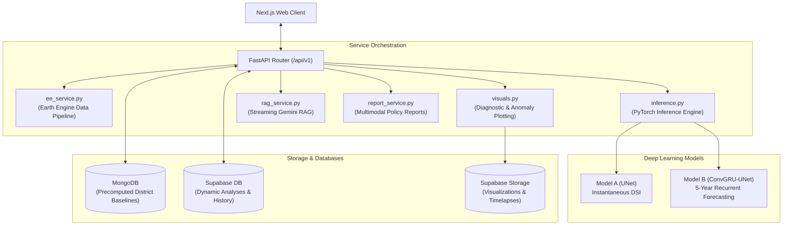

# Desertification Risk API (Backend)

[](https://fastapi.tiangolo.com/)
[](https://www.python.org/downloads/)
[](https://pytorch.org/)
[](https://earthengine.google.com/)
[](https://ai.google.dev/)

The core computational and inference engine for the Sindh Desertification Risk Monitoring & Forecasting platform. Built with **FastAPI**, **PyTorch**, and **Google Earth Engine**, this service orchestrates remote sensing data extraction, deep learning inference, automated visual diagnostics generation, dual-database persistence, and multimodal generative AI reporting.

---

## 🏛️ System Architecture



---

## 🛠️ Modules & Service Breakdown

### 1. `app/services/ee_service.py` (Earth Engine Ingestion)
- Connects to Google Earth Engine via Service Account / Cloud Project credentials.
- Automates multi-sensor spatial clipping and cloud-masked temporal compositing for user-defined bounding boxes:
  - **Sentinel-1 GRD:** VV, VH backscatter, and $\text{VV}/\text{VH}$ ratio.
  - **Sentinel-2 MSI:** Surface reflectance bands (B2, B4, B8, B11) and spectral indices (NDVI, NDWI, MSI, NDDI, SAVI, EVI).
  - **MODIS:** Land Surface Temperature (LST), Evapotranspiration (ET), and Leaf Area Index (LAI).
  - **Climate & Topography:** CHIRPS precipitation, TerraClimate metrics, SRTM elevation/slope/aspect, and SoilGrids parameters.
- Exports multi-band GeoTIFF rasters locally for downstream inference.

### 2. `app/models/` (Neural Network Architectures)
- **`unet.py` (Model A - Spatio-Temporal UNet):**
  - Input: `(B, 33, 64, 64)` multi-sensor raster.
  - Building blocks: `DoubleConv` (Conv2D $\to$ GroupNorm $\to$ SiLU) with 4 downsampling stages (MaxPool) and 4 upsampling stages (ConvTranspose2d) with skip connections.
  - Output: `(B, 1, 64, 64)` continuous Desertification Sensitivity Index ($DSI \in [0, 1]$).
- **`convgru.py` (Model B - ConvGRU-UNet Seq2Seq):**
  - Input: `(B, T, 1, 64, 64)` quarterly historical DSI sequences.
  - Architecture: Shared spatial CNN encoder $\to$ ConvGRU recurrent temporal encoder $\to$ ConvGRU recurrent temporal decoder $\to$ Transposed convolution spatial reconstruction with skip connections.
  - Output: Multi-year autoregressive quarterly forecasts ($2026 \to 2030$).

### 3. `app/services/inference.py` (Inference Pipelines)
- Handles raster tiling, min-max normalisation using precomputed training distribution statistics, device mapping (CUDA/CPU), batch execution, and spatial GeoTIFF re-projection.

### 4. `app/services/visuals.py` (Diagnostic & Anomaly Plotting)
- Generates publication-ready figures encoded as base64 / PNG:
  - **4-Panel Diagnostic Dashboards:** DSI heatmap, categorized degradation risk levels, elevation contours, and land-use overlays.
  - **Feature Importance & Hexbins:** Attributive feature ranking and joint bivariate distributions for top driving factors.
  - **Forecast Diagnostics:** Multi-year temporal trend lines, seasonal variance bands, stacked risk category transitions, and animated timelapse GIFs.

### 5. `app/services/rag_service.py` & `report_service.py` (Gemini Multimodal AI)
- **RAG Copilot:** Streaming conversational assistant leveraging Google Gemini (`gemini-1.5-flash` / `gemini-2.0-flash`). Integrates conversational history and regional domain knowledge regarding Sindh's agro-climatic zones.
- **Automated Policy Reports:** Analyzes visual outputs and regional statistics to generate structured executive policy briefs with actionable mitigation strategies (afforestation, irrigation reforms, soil conservation).

### 6. `app/services/mongodb_service.py` & `supabase_service.py` (Persistence)
- **MongoDB:** High-speed querying of precomputed district boundaries, baseline rasters, and pre-generated AI reports.
- **Supabase:** Stores dynamic user-drawn analysis sessions, relational metadata, and hosts visual artifacts (PNGs and GIFs) in the `desertification-visuals` storage bucket.

---

## 📡 API Endpoint Reference

All endpoints are prefixed with `/api/v1`.

### 1. Analysis Endpoints
- **`POST /api/v1/analyze/current`**
  - **Description:** Runs on-demand multi-spectral data fetching and Model A inference for a user-specified bounding box.
  - **Request Body:**
    ```json
    {
      "coordinates": [[68.35, 25.39], [68.45, 25.39], [68.45, 25.49], [68.35, 25.49], [68.35, 25.39]],
      "area_sq_km": 105.4
    }
    ```
  - **Response:** Returns `analysis_id`, status, and Supabase CDN URLs for generated dashboards, feature importance graphs, and hexbin plots.

- **`POST /api/v1/analyze/forecast`**
  - **Description:** Fetches historical quarterly sequences and runs Model B autoregressive forecasting.
  - **Response:** Returns `analysis_id` and URLs for anomaly maps, seasonal trends, stacked distribution charts, and animated timelapse GIFs.

### 2. Administrative District Queries
- **`GET /api/v1/search?q={query}`**
  - Provides instant autocomplete search across all Sindh districts stored in MongoDB.
- **`GET /api/v1/district/{name}`**
  - Fetches cached baseline and forecast analytical payloads for a specific district (e.g., `Hyderabad`, `Tharparkar`).

### 3. History & Asset Management
- **`GET /api/v1/history`**
  - Retrieves all historical user-generated analyses in reverse chronological order.
- **`DELETE /api/v1/history/{analysis_id}`**
  - Deletes the analysis record and purges all associated image files from Supabase Storage.

### 4. Generative AI Services
- **`POST /api/v1/history/{analysis_id}/report`**
  - Triggers Google Gemini to synthesize a multimodal policy brief based on the analysis results. Caches report back to MongoDB or Supabase.
- **`POST /api/v1/rag`**
  - **Streaming endpoint** delivering real-time token-by-token responses for the conversational Copilot.
  - **Request Body:**
    ```json
    {
      "query": "What are the primary factors driving desertification in this district?",
      "history": [{"role": "user", "text": "..."}, {"role": "ai", "text": "..."}]
    }
    ```

---

## 🚀 Setup & Installation

### 1. Requirements
- Python 3.10 or higher
- [uv](https://docs.astral.sh/uv/) (recommended) or standard `pip`
- Google Earth Engine authenticated account / service account JSON
- MongoDB instance (local or Atlas)
- Supabase project credentials
- Google Gemini API key

### 2. Virtual Environment Setup
```bash
# Clone the repository and navigate to backend
cd desertification_api

# Create and activate virtual environment with uv
uv venv
# On Windows:
.venv\Scripts\activate
# On Linux / macOS:
source .venv/bin/activate

# Install dependencies in editable mode
uv pip install -e .
```

### 3. Environment Variables
Create a `.env` file in the `desertification_api` directory:
```bash
cp .env.example .env
```

Fill in the required configurations:
```env
# Application Settings
ENVIRONMENT=development
PORT=9000
TEMP_DIR=./tmp

# Google Earth Engine
GEE_PROJECT_ID=your-google-cloud-project-id

# MongoDB
MONGO_URI=mongodb+srv://<username>:<password>@cluster.mongodb.net/
MONGO_DB_NAME=sindh_desertification

# Supabase
SUPABASE_URL=https://your-project.supabase.co
SUPABASE_SERVICE_ROLE_KEY=your-supabase-service-role-key
SUPABASE_BUCKET_NAME=desertification-visuals

# Google Gemini API
GEMINI_API_KEY=your-gemini-api-key
```

### 4. Start the Application
```bash
python main.py
```
Or run directly with `uvicorn`:
```bash
uvicorn app.main:app --host 0.0.0.0 --port 9000 --reload
```

The interactive OpenAPI documentation will be available at:
- **Swagger UI:** [http://localhost:9000/docs](http://localhost:9000/docs)
- **ReDoc:** [http://localhost:9000/redoc](http://localhost:9000/redoc)
