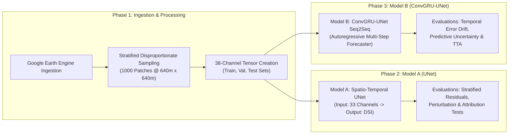

# Experimentation Suite & Research Methodology

[](https://pytorch.org/)
[](https://jupyter.org/)
[](https://earthengine.google.com/)
[](https://huggingface.co/)

This directory houses the complete research, dataset creation, machine learning model experimentation, training routines, ablation studies, and evaluation benchmarks for the **Spatio-Temporal AI Framework for Sindh Desertification Risk Prediction and Forecasting (STAFDRS)**.

---

## 🔬 Overview of Experimental Workflow

The experimental methodology is divided into three distinct phases:



---

## 📁 Directory Structure & Notebook Directory

```text
experimentation/
├── initial_data_collection_and_processing.md  # Detailed technical document on data pipeline
├── problems.txt                               # Validation and quality inspection logs for 38 channels
├── creating_kaggle_dataset.ipynb              # Notebook exporting curated datasets to Kaggle / Drive
├── spatio_temporal_sindh_desertification.ipynb# Initial exploratory spatial data analysis
│
├── model_a/                                   # Model A: Instantaneous DSI Estimator (UNet)
│   ├── notebooks/
│   │   ├── spatio-temporal-unet-model-1.ipynb          # Model A training & checkpointing
│   │   ├── spatio-temporal-unet-model-1.md             # Model A technical documentation
│   │   ├── spatio_temporal_unet_inference.ipynb        # Single-patch case study inference
│   │   ├── spatio_temporal_unet_inference.md           # Model A inference documentation
│   │   └── spatio_temporal_unet_inference_extended.ipynb# Advanced multi-region batch inference
│   ├── metrics/                               # Training loss curves & validation telemetry
│   └── tests/                                 # Stratified evaluation charts & perturbation outputs
│
└── model_b/                                   # Model B: Multi-Year Forecaster (ConvGRU-UNet)
    ├── notebooks/
    │   ├── spatio-temporal-unet-convgru-model-2.ipynb  # Model B Seq2Seq training
    │   ├── spatio-temporal-unet-convgru-model-2.md     # Model B technical documentation
    │   ├── spatio_temporal_convgru_unet_inference.ipynb# 5-Year rolling forecast inference
    │   ├── spatio_temporal_convgru_unet_inference.md   # Model B inference documentation
    │   └── spatio_temporal_convgru_unet_inference_extended.ipynb# Extended horizon rollout tests
    ├── metrics/                               # Recurrent loss curves & convergence plots
    └── tests/                                 # Temporal error drift curves & uncertainty maps
```

---

## 🧪 Model Comparison Summary

| Metric / Dimension | Model A (UNet) | Model B (ConvGRU-UNet) |
| :--- | :--- | :--- |
| **Objective** | Multi-sensor spatial estimation of current DSI | Autoregressive spatio-temporal forecasting ($2026 \to 2030$) |
| **Input Tensor Shape** | `(Batch, 33, 64, 64)` | `(Batch, 4, 1, 64, 64)` (Quarterly historical DSI) |
| **Target Tensor Shape**| `(Batch, 1, 64, 64)` | `(Batch, 4, 1, 64, 64)` (Subsequent quarterly rollout) |
| **Recurrent Temporal Units** | None (Spatial 2D CNN with skip connections) | Convolutional GRU (ConvGRU) with 2D spatial feature states |
| **Loss Function** | DSI-Weighted MSE + MAE ($w=10$ for $DSI \ge 0.6$) | Multi-step Weighted Spatio-Temporal MSE |
| **Training Horizons** | $2016 \to 2023$ (400 patches $\times$ 96 months) | $2016 \to 2023$ (Sliding 34-month windows) |
| **Generalization Test Set**| $2024 \to 2026$ (500 unseen geographic patches) | $2024 \to 2026$ (Spatial & temporal disjoint evaluation) |

---

## 📈 Advanced Evaluation Protocols

1. **Stratified Error Analysis:** Evaluates prediction residuals partitioned across primary agro-ecological land classes (Agricultural cropland, Arid desert, Shrubland, and Coastal mangroves) to detect class-conditional systematic bias.
2. **Input Perturbation & Feature Importance:** Assesses sensitivity by systematically zeroing or jittering individual input channels (e.g., LST, NDVI, Soil Organic Carbon, VPD) to quantify empirical feature importance rankings.
3. **Temporal Error Drift Analysis:** Tracks error accumulation across autoregressive recurrence steps to ensure model stability across extended rollout horizons.
4. **Predictive Uncertainty & Test-Time Augmentation (TTA):** Employs spatial flips and rotations during inference to compute pixel-wise variance maps as predictive uncertainty indicators.
