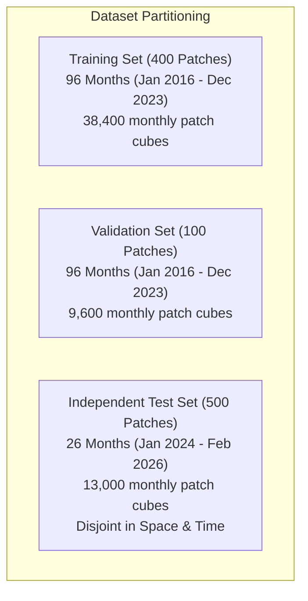

# Initial Data Collection, Spatial Sampling, and Processing Pipeline

[](https://earthengine.google.com/)
[](https://esa-worldcover.org/)
[](https://www.isric.org/explore/soilgrids)
[](https://www.climatologylab.org/terraclimate.html)

This document provides a comprehensive technical overview of the remote sensing ingestion pipeline, spatial sampling framework, channel definitions, quality control protocols, and tensor construction used across the **STAFDRS** project.

---

## 🗺️ 1. Geographic Extent & Study Area

The study area encompasses the entire province of **Sindh, Pakistan** ($\approx 140,914\text{ km}^2$), situated between latitudes $23^\circ 35' \text{ N}$ to $28^\circ 30' \text{ N}$ and longitudes $66^\circ 42' \text{ E}$ to $71^\circ 10' \text{ E}$. 

Sindh is characterized by pronounced ecological vulnerability:
- **Arid to Hyper-Arid Climatic Regime:** High summer temperatures frequently exceeding $45^\circ\text{C}$ and sparse, erratic precipitation ($100\text{ mm}$ to $300\text{ mm}$ annually).
- **Heterogeneous Agro-Ecological Zones:**
  - **Indus River Plain:** Intensively irrigated agricultural land vulnerable to waterlogging, secondary salinization, and canal seepage.
  - **Thar and Nara Deserts:** Fragile sand-dune ecosystems subject to severe wind erosion, overgrazing, and vegetation loss.
  - **Kohistan Range:** Arid hilly terrain with rocky outcrops, high slope, and low soil organic matter.
  - **Indus Delta & Coastal Zone:** Mangrove ecosystems facing sea-water intrusion, tidal degradation, and freshwater discharge reduction.

---

## 📍 2. Stratified Disproportionate Sampling Strategy

To prevent representation bias toward predominant desert surfaces and ensure the deep learning models learn degradation transitions across all ecosystems, a **Stratified Disproportionate Sampling** scheme was implemented using the **ESA WorldCover 10m** dataset:

| Stratum ID | Ecological Land Cover Stratum | Sample Count | Sampling Proportion | Ecological Significance |
| :---: | :--- | :---: | :---: | :--- |
| **1** | **Agricultural Cropland** | 300 | 30.0% | Food security, secondary salinization, and crop health dynamics |
| **2** | **Arid / Bare Desert** | 300 | 30.0% | Active desert zones, baseline hyper-arid degradation targets |
| **3** | **Shrubland / Grassland** | 200 | 20.0% | Transitional rangelands exhibiting highest risk of desertification |
| **4** | **Coastal / Mangrove Wetland** | 200 | 20.0% | Saline intrusion, deltaic decline, and coastal erosion dynamics |
| **Total**| **All Strata Combined** | **1,000** | **100.0%** | Comprehensive spatial representation across Sindh |

---

## 📐 3. Spatial Patch Geometry & Physical Dimensions

Each sampling point serves as the centroid for an exported spatial patch:
- **Spatial Resolution:** $10\text{ meters per pixel}$ (matched to Sentinel-2 MSI visible bands).
- **Patch Resolution:** $64 \times 64\text{ pixels}$.
- **Ground Footprint:** $640\text{ meters} \times 640\text{ meters}$ ($0.4096\text{ km}^2$ per patch).
- **Coordinate Reference System:** EPSG:4326 (WGS 84), projected uniformly to EPSG:32642 (UTM Zone 42N) during spatial resampling.

---

## ⏱️ 4. Temporal Partitioning & Dataset Splits

The temporal coverage spans from **January 2016 through February 2026** (122 continuous months):



- **Spatial Disjointness:** The 500 test patches are located at distinct geographical coordinates that never appear in the training or validation splits.
- **Temporal Disjointness:** The test period ($2024 \to 2026$) evaluates model generalization under evolving climate trajectories without future information leakage.

---

## 📊 5. Comprehensive 38-Channel Feature Catalog

Each patch contains **38 co-registered channels** harmonized to uniform $64 \times 64$ dimensions:

```text
Channels 0 - 32:  Multi-Sensor Satellite & Environmental Observations (Model Inputs)
Channels 33 - 36: Intermediate MEDALUS Quality Indices (CQI, VQI, SQI, LQI)
Channel 37:       Ground Truth Desertification Sensitivity Index (Target DSI)
```

### Detailed Channel Specifications

| Channel # | Channel Name | Source Platform / Dataset | Description / Calculation |
| :---: | :--- | :--- | :--- |
| **0** | `s1_vv` | Sentinel-1 SAR GRD | C-band vertical transmit/vertical receive backscatter ($\text{dB}$) |
| **1** | `s1_vh` | Sentinel-1 SAR GRD | C-band vertical transmit/horizontal receive cross-polarization ($\text{dB}$) |
| **2** | `s1_ratio` | Sentinel-1 SAR GRD | Cross-polarization ratio: $\text{VV} / \text{VH}$ (surface roughness proxy) |
| **3** | `s2_b2` | Sentinel-2 MSI | Blue reflectance ($490\text{ nm}$, $10\text{m}$) |
| **4** | `s2_b4` | Sentinel-2 MSI | Red reflectance ($665\text{ nm}$, $10\text{m}$) |
| **5** | `s2_b8` | Sentinel-2 MSI | Near-Infrared (NIR) reflectance ($842\text{ nm}$, $10\text{m}$) |
| **6** | `s2_b11`| Sentinel-2 MSI | Short-Wave Infrared (SWIR-1) reflectance ($1610\text{ nm}$, $20\text{m} \to 10\text{m}$) |
| **7** | `ndvi` | Sentinel-2 MSI | $(\text{NIR} - \text{Red}) / (\text{NIR} + \text{Red})$ |
| **8** | `ndwi` | Sentinel-2 MSI | $(\text{NIR} - \text{SWIR}) / (\text{NIR} + \text{SWIR})$ (Canopy water content) |
| **9** | `msi` | Sentinel-2 MSI | $\text{SWIR} / \text{NIR}$ (Moisture Stress Index) |
| **10** | `nddi` | Sentinel-2 MSI | $(\text{NDVI} - \text{NDWI}) / (\text{NDVI} + \text{NDWI})$ (Drought severity) |
| **11** | `savi` | Sentinel-2 MSI | $[(\text{NIR} - \text{Red}) / (\text{NIR} + \text{Red} + 0.5)] \times 1.5$ |
| **12** | `evi` | Sentinel-2 MSI | $2.5 \times [(\text{NIR} - \text{Red}) / (\text{NIR} + 6\text{Red} - 7.5\text{Blue} + 1)]$ |
| **13** | `lst_celsius` | MODIS Terra (MOD11A2) | Land Surface Temperature daytime ($^\circ\text{C}$, $1\text{km} \to 10\text{m}$) |
| **14** | `et_modis` | MODIS (MOD16A2) | Actual Evapotranspiration ($\text{kg/m}^2/8\text{day}$, $500\text{m} \to 10\text{m}$) |
| **15** | `lai_modis`| MODIS (MCD15A2H) | Leaf Area Index ($\text{m}^2/\text{m}^2$, $500\text{m} \to 10\text{m}$) |
| **16** | `rain` | CHIRPS Daily / Monthly | High-resolution satellite-gauge blended rainfall ($\text{mm/month}$) |
| **17** | `tc_pr` | TerraClimate | Monthly total precipitation ($\text{mm}$) |
| **18** | `tc_pet` | TerraClimate | Potential evapotranspiration ($\text{mm}$) |
| **19** | `tc_tmax`| TerraClimate | Maximum 2m monthly temperature ($^\circ\text{C}$) |
| **20** | `tc_tmin`| TerraClimate | Minimum 2m monthly temperature ($^\circ\text{C}$) |
| **21** | `tc_vpd` | TerraClimate | Vapor Pressure Deficit ($\text{kPa}$) |
| **22** | `tc_pdsi`| TerraClimate | Palmer Drought Severity Index (PDSI) |
| **23** | `soc` | ISRIC SoilGrids 250m | Soil Organic Carbon content at $0\text{--}30\text{cm}$ depth ($\text{g/kg}$) |
| **24** | `texture`| ISRIC SoilGrids 250m | USDA soil texture classification index |
| **25** | `bulk_density`| ISRIC SoilGrids 250m | Bulk density of the fine earth fraction ($\text{cg/cm}^3$) |
| **26** | `elevation` | NASA SRTM DEM 30m | Digital Elevation Model ($1\text{m}$ vertical resolution) |
| **27** | `slope` | NASA SRTM DEM 30m | Topographic slope gradient (degrees) |
| **28** | `aspect` | NASA SRTM DEM 30m | Topographic aspect / orientation (degrees) |
| **29** | `hillshade` | NASA SRTM DEM 30m | Shaded relief illumination intensity ($0\text{--}255$) |
| **30** | `night_lights` | NOAA VIIRS DNB | Monthly cloud-free day/night band radiance ($\text{nW}\cdot\text{cm}^{-2}\cdot\text{sr}^{-1}$) |
| **31** | `pop_dens` | WorldPop Constrained | Population density estimate (people per $\text{km}^2$) |
| **32** | `lc` | Dynamic World 10m | Near-real-time global land cover probability label |
| **33** | `cqi` | MEDALUS Climate Model | Climate Quality Index: $f(\text{Rainfall}, \text{PET}, \text{Aridity}, \text{Aspect})$ |
| **34** | `vqi` | MEDALUS Vegetation Model| Vegetation Quality Index: $f(\text{Erosion Protection}, \text{Drought Resistance}, \text{Plant Cover})$ |
| **35** | `sqi` | MEDALUS Soil Model | Soil Quality Index: $f(\text{Parent Material}, \text{Texture}, \text{Depth}, \text{Drainage})$ |
| **36** | `lqi` | MEDALUS Management Model| Land Management / Policy Index: $f(\text{Grazing Pressure}, \text{Policy Intensity})$ |
| **37** | **`dsi`** | **MEDALUS Framework** | **Desertification Sensitivity Index:** $\sqrt[4]{\text{CQI} \times \text{VQI} \times \text{SQI} \times \text{LQI}}$ |

---

## 🛠️ 6. Quality Assurance, Cloud Masking & Imputation

As logged during dataset verification (see `problems.txt`):
1. **Cloud & Shadow Masking:** Sentinel-2 Level-2A QA60 and Scene Classification Layer (SCL) bitmasks were used to eliminate clouds, cirrus, and cloud shadows prior to calculating median monthly composites.
2. **Missing Satellite Observations:** Certain coarse-resolution climate collections (e.g., MODIS Terra / TerraClimate) undergo delayed monthly reporting. Missing channels in specific test months were filled using historical climatological mean imputation or forward temporal propagation to ensure consistent tensor shapes.
3. **Outlier Filtering & Normalization:** Extreme radar speckle in Sentinel-1 was clamped to $[-30\text{ dB}, 5\text{ dB}]$, and physical indices were clipped to their mathematically bounded intervals (e.g., NDVI in $[-1.0, 1.0]$).

---

## 💾 7. Tensor Serialization & Directory Layout

Data was exported from GEE via Google Drive, consolidated, and serialized into PyTorch binary tensor files (`.pt`):

```text
data/
├── train/          # 400 .pt files: shape (96, 38, 64, 64) [Jan 2016 - Dec 2023]
├── val/            # 100 .pt files: shape (96, 38, 64, 64) [Jan 2016 - Dec 2023]
└── test/           # 500 .pt files: shape (26, 38, 64, 64) [Jan 2024 - Feb 2026]
```

These files serve as the unified benchmark foundation for both **Model A** and **Model B**.
