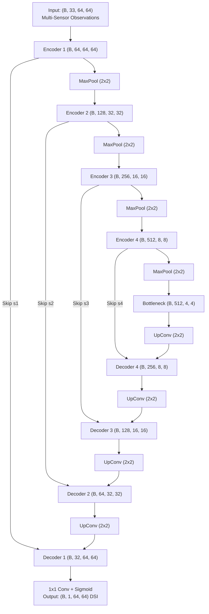

# Model A: Spatio-Temporal UNet for Desertification Sensitivity Index (DSI) Estimation

This document details the architectural design, mathematical formulation, loss weighting strategy, training routine, and advanced evaluation suite for **Model A**, a deep convolutional UNet designed to estimate continuous spatial maps of the Desertification Sensitivity Index (DSI) from multi-sensor satellite and environmental observations.

---

## 🏗️ 1. Detailed Model Architecture

Model A employs an adapted **UNet** backbone with symmetric encoder-decoder paths and skip connections. To maintain training stability across heterogeneous multi-sensor inputs without relying on large batch statistics, standard BatchNorm is replaced with **GroupNorm** ($G = \max(1, C/8)$) and paired with smooth **SiLU** activations.

### Layer Dimensions & Channel Progression

| Stage | Operation / Block | In Channels | Out Channels | Feature Map Resolution | Skip Connection Source |
| :--- | :--- | :---: | :---: | :---: | :---: |
| **Input** | Raw Multi-Spectral Batch | — | 33 | $64 \times 64$ | — |
| **Enc 1** | DoubleConv (Conv3x3, GN, SiLU) $\times 2$ | 33 | 64 | $64 \times 64$ | To Dec 1 (`s1`) |
| **Down 1** | MaxPool2d (stride 2) | 64 | 64 | $32 \times 32$ | — |
| **Enc 2** | DoubleConv (Conv3x3, GN, SiLU) $\times 2$ | 64 | 128 | $32 \times 32$ | To Dec 2 (`s2`) |
| **Down 2** | MaxPool2d (stride 2) | 128 | 128 | $16 \times 16$ | — |
| **Enc 3** | DoubleConv (Conv3x3, GN, SiLU) $\times 2$ | 128 | 256 | $16 \times 16$ | To Dec 3 (`s3`) |
| **Down 3** | MaxPool2d (stride 2) | 256 | 256 | $8 \times 8$ | — |
| **Enc 4** | DoubleConv (Conv3x3, GN, SiLU) $\times 2$ | 256 | 512 | $8 \times 8$ | To Dec 4 (`s4`) |
| **Down 4** | MaxPool2d (stride 2) | 512 | 512 | $4 \times 4$ | — |
| **Bottleneck** | DoubleConv (Conv3x3, GN, SiLU) $\times 2$ | 512 | 512 | $4 \times 4$ | Latent Representation |
| **Up 4** | ConvTranspose2d (stride 2) + Concat | $512 + 512$ | 512 | $8 \times 8$ | Concat `s4` |
| **Dec 4** | DoubleConv (Conv3x3, GN, SiLU) $\times 2$ | 512 | 256 | $8 \times 8$ | — |
| **Up 3** | ConvTranspose2d (stride 2) + Concat | $256 + 256$ | 256 | $16 \times 16$ | Concat `s3` |
| **Dec 3** | DoubleConv (Conv3x3, GN, SiLU) $\times 2$ | 256 | 128 | $16 \times 16$ | — |
| **Up 2** | ConvTranspose2d (stride 2) + Concat | $128 + 128$ | 128 | $32 \times 32$ | Concat `s2` |
| **Dec 2** | DoubleConv (Conv3x3, GN, SiLU) $\times 2$ | 128 | 64 | $32 \times 32$ | — |
| **Up 1** | ConvTranspose2d (stride 2) + Concat | $64 + 64$ | 64 | $64 \times 64$ | Concat `s1` |
| **Dec 1** | DoubleConv (Conv3x3, GN, SiLU) $\times 2$ | 64 | 32 | $64 \times 64$ | — |
| **Head** | Conv2d ($1 \times 1$) + Sigmoid | 32 | 1 | $64 \times 64$ | Continuous DSI $[0, 1]$ |

---

## 📦 2. Dataset Engineering & Sample Unrolling

Data is parsed from monthly multi-band tensors (`.pt` files) containing 38 channels:
- **Input Channels ($0 \to 32$):** Synthetic Aperture Radar (VV, VH, ratio), Optical bands, Vegetation & Moisture indices, Thermal LST, Evapotranspiration, Hydrology, Soil properties, DEM elevation, Nightlights, Population, and Land Cover.
- **Target Channel ($37$):** Ground truth continuous DSI map $[B, 1, 64, 64]$.

### Sample Breakdown
- **Training Set (400 patches $\times$ 96 months):** $38,400\text{ samples}$ (Jan 2016 – Dec 2023).
- **Validation Set (100 patches $\times$ 96 months):** $9,600\text{ samples}$ (Jan 2016 – Dec 2023).
- **Out-of-Domain Test Set (500 patches $\times$ 26 months):** $13,000\text{ samples}$ (Jan 2024 – Feb 2026).

---

## ⚖️ 3. DSI-Weighted Loss Formulation

In environmental remote sensing, severe land degradation ($DSI \ge 0.6$) represents a minority class compared to stable agricultural land or moderately arid baseline soils. Unweighted MSE loss causes gradient dilution, under-predicting extreme vulnerability.

To counteract this imbalance, an **exponentially tiered DSI-weighted compound loss** is utilized:

$$\mathcal{L}_{\text{total}} = \frac{1}{N} \sum_{i=1}^N w(y_i) \cdot \left[ \alpha \cdot (y_i - \hat{y}_i)^2 + (1 - \alpha) \cdot |y_i - \hat{y}_i| \right]$$

where $\alpha = 0.5$, and sample-wise pixel penalty weights $w(y)$ follow:

$$w(y) = \begin{cases} 
1.0 & \text{if } y < 0.2 \quad (\text{Low sensitivity / non-threatened}) \\
2.0 & \text{if } 0.2 \le y < 0.4 \quad (\text{Moderate sensitivity}) \\
5.0 & \text{if } 0.4 \le y < 0.6 \quad (\text{High sensitivity / transitional}) \\
10.0 & \text{if } y \ge 0.6 \quad (\text{Critical desertification / severe risk})
\end{cases}$$

---

## 🚀 4. Training Protocol & Hugging Face Integration

- **Optimizer:** `AdamW` ($\beta_1 = 0.9$, $\beta_2 = 0.999$, weight decay $= 10^{-4}$).
- **Learning Rate Schedule:** Cosine Annealing with Warm Restarts ($\text{lr}_{\max} = 3 \times 10^{-4}$, $\text{lr}_{\min} = 10^{-6}$).
- **Batch Size:** 32 on NVIDIA GPU.
- **Data Augmentation:** Random horizontal and vertical flips, random $90^\circ$ rotations applied consistently across all input and target spatial channels.
- **Cloud Checkpointing:** Model weights, optimizer states, and validation metrics are pushed automatically to the Hugging Face Hub after each validation epoch to safeguard against runtime interruptions.

---

## 🔬 5. Advanced Evaluation & Validation Tests

### 1. Stratified Residual Analysis
Residual errors ($\hat{y} - y$) are segmented across the four primary agro-ecological zones (Agricultural, Arid Desert, Shrubland, Coastal Mangrove) to evaluate error homoscedasticity.

### 2. Input Perturbation Sensitivity
Input channels are sequentially perturbed with Gaussian noise ($\mu=0, \sigma=1$) or zero-masked to observe mean degradation shifts ($\Delta \text{DSI}$). This quantitative attribution confirms Land Surface Temperature (LST), Soil Organic Carbon (SOC), and Vapor Pressure Deficit (VPD) as dominant predictors.

### 3. Spatial Residual Mapping
Pixel-level absolute difference maps $|y - \hat{y}|$ are mapped over regional test patches (e.g., Hyderabad and Tharparkar) to inspect boundary preservation along riverine-desert interfaces.
