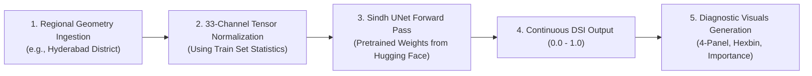

# Model A: Spatio-Temporal UNet Inference Pipeline & Visual Diagnostics

[](https://pytorch.org/)
[](https://jupyter.org/)
[](https://huggingface.co/)

This notebook and guide document the complete inference workflow for **Model A (Spatio-Temporal UNet)**, showcasing how multi-band regional observations are transformed into high-resolution Desertification Sensitivity Index (DSI) heatmaps, diagnostic dashboards, and feature attribution charts.

---

## 🔄 End-to-End Inference Workflow



---

## 🛠️ Step-by-Step Implementation Details

### Step 1: Geospatial Ingestion
- Regional bounding box or polygon geometry is passed to the data loader.
- 33 input channels are extracted for the target observation timestamp (e.g., February 2024 or real-time Sentinel-1/2 composites).
- Extracted raster data is converted into a tensor of shape `(1, 33, 64, 64)`.

### Step 2: Tensor Preprocessing & Normalization
- Each channel $c \in \{0, \dots, 32\}$ is scaled using global channel-wise min/max statistics computed across the 400 training patches:
  $$\tilde{x}_c = \frac{x_c - \min(X_c)}{\max(X_c) - \min(X_c) + \epsilon}$$
- Missing observations (if any) are imputed via zero-fill or local spatial median smoothing.

### Step 3: Model Architecture & Pretrained Weight Loading
- Model architecture is instantiated with 33 input channels and 1 output channel.
- Pretrained weights are downloaded directly from the Hugging Face repository or loaded from local cache:
  ```python
  from app.models.unet import SindhUNet
  import torch

  device = torch.device("cuda" if torch.cuda.is_available() else "cpu")
  model = SindhUNet(in_channels=33, out_channels=1).to(device)
  
  # Load weights
  checkpoint = torch.load("weights/model_a_unet_best.pth", map_location=device)
  model.load_state_dict(checkpoint["model_state_dict"])
  model.eval()
  ```

### Step 4: Forward Pass & Spatial GeoTIFF Export
- Inference is executed within a `torch.no_grad()` context:
  ```python
  with torch.no_grad():
      pred_dsi = model(tensor_batch) # Shape: (1, 1, 64, 64)
  ```
- Output values are projected to physical continuous DSI in the range $[0.0, 1.0]$.
- Coordinates and affine transforms are attached to save the prediction as a georeferenced GeoTIFF.

---

## 📊 Analytical Visualizations Suite

The inference pipeline generates an integrated suite of analytical diagnostics:

### 1. Four-Panel Diagnostic Dashboard
1. **Satellite Input Composite:** False-color or natural RGB composite (Sentinel-2 B8-B4-B2 or B4-B3-B2) displaying ground vegetative patterns.
2. **Estimated Continuous DSI Map:** Color-mapped heatmap from low risk (deep green) to extreme sensitivity (crimson red).
3. **Categorical Risk Stratification:** Discrete MEDALUS sensitivity classes:
   - *Class 1: Non-threatened* ($DSI < 0.20$)
   - *Class 2: Moderate Sensitivity* ($0.20 \le DSI < 0.40$)
   - *Class 3: Sensitive* ($0.40 \le DSI < 0.60$)
   - *Class 4: Critical Desertification Risk* ($DSI \ge 0.60$)
4. **Topographic & Soil Overlay:** Digital elevation contours and soil texture indices illustrating geomorphological vulnerability.

### 2. Full 33-Channel Multi-Band Spatial Grid
- A complete $6 \times 6$ sub-plot grid rendering individual spatial patterns for radar backscatter, optical reflectance, water/vegetation indices, thermal LST, precipitation, soil properties, and demographic nightlights.

### 3. Global Feature Importance Ranking
- Systematic perturbation sensitivity ranking displaying the percentage contribution of each feature toward the predicted DSI value.

### 4. Bivariate Hexbin Joint Distribution Plots
- Hexbin density scatter plots correlating the top two driving predictors (e.g., Land Surface Temperature and Soil Organic Carbon) against continuous DSI, revealing non-linear risk thresholds.
