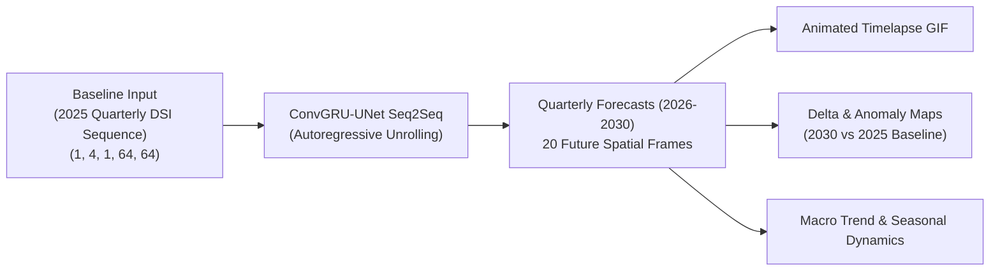

# Model B: ConvGRU-UNet Multi-Year Forecasting Inference & Analytical Suite

[](https://pytorch.org/)
[](https://jupyter.org/)
[](https://github.com/ahmedfarazsyk/sindh-desertification-risk-prediction-and-forecasting)

This notebook and guide detail the operational inference workflow for **Model B (ConvGRU-UNet)**, demonstrating how quarterly baseline sequences are unrolled autoregressively to project multi-year spatial trajectories of the Desertification Sensitivity Index (DSI) from 2026 through 2030 across Sindh.

---

## 🔄 Autoregressive Forecasting Pipeline



---

## 🛠️ Step-by-Step Implementation Details

### Step 1: Baseline Input Sequence Ingestion
- For any target geographical region (e.g., Hyderabad, Tharparkar, or custom bounding boxes), quarterly DSI rasters are assembled for the preceding 12-month baseline (e.g., 2025: January, April, July, and October).
- The four quarterly rasters are stacked into an input tensor of shape `(1, 4, 1, 64, 64)`.

### Step 2: Architecture Initialization & Weight Loading
- The `SindhConvGRUUNet` model is initialized and synced with the best-performing training checkpoint:
  ```python
  from app.models.convgru import SindhConvGRUUNet
  import torch

  device = torch.device("cuda" if torch.cuda.is_available() else "cpu")
  model = SindhConvGRUUNet().to(device)

  checkpoint = torch.load("weights/model_b_convgru_best.pth", map_location=device)
  model.load_state_dict(checkpoint["model_state_dict"])
  model.eval()
  ```

### Step 3: Autoregressive Recursive Rollout
- Multi-year horizons are generated by autoregressively feeding forecasted outputs back as conditioning inputs for subsequent steps:
  ```python
  forecast_frames = []
  current_input = baseline_sequence.to(device) # Shape: (1, 4, 1, 64, 64)

  with torch.no_grad():
      for year in range(2026, 2031):
          # Generate next 4 quarters
          next_year_pred = model(current_input) # Shape: (1, 4, 1, 64, 64)
          forecast_frames.append(next_year_pred)
          # Update rolling input window
          current_input = next_year_pred
  ```
- Yields a continuous sequence of 20 spatial frames covering 20 quarters ($2026\text{ Q1} \to 2030\text{ Q4}$).

---

## 📊 Analytical Visualizations Suite

The forecasting notebook generates an extensive battery of diagnostic and analytical visual artifacts:

### 1. Quarterly Forecast Spatial Grid ($2026 \to 2030$)
- A $5 \times 4$ multi-panel spatial grid rendering each of the 20 forecasted quarters under a unified perceptually uniform colormap (Viridis / YlOrRd) to trace seasonal greening and dry-season degradation pulses.

### 2. Animated Timelapse GIF (`timelapse.gif`)
- A continuous animated GIF visualizing the fluid expansion and retreat of desertification risk fronts over the 5-year projection window.

### 3. Quarterly & Annual Distribution Histograms
- Histograms tracking the progressive reallocation of land area across the four MEDALUS sensitivity classes:
  - Non-threatened ($DSI < 0.2$)
  - Moderate ($0.2 \le DSI < 0.4$)
  - Sensitive ($0.4 \le DSI < 0.6$)
  - Critical ($DSI \ge 0.6$)

### 4. Forecasted Spatial Change Map ($\Delta \text{DSI}$)
- Direct subtraction of the 2025 baseline annual mean from the 2030 projected annual mean:
  $$\Delta \text{DSI}_{i,j} = \overline{\text{DSI}}_{2030, i,j} - \overline{\text{DSI}}_{2025, i,j}$$
- Identifies emerging degradation hotspots (positive $\Delta \text{DSI}$) versus ecologically recovering or stable zones.

### 5. Seasonal Fluctuation & Monsoon Buffering Curves
- Line plots disaggregating the forecasted trajectory into seasonal cycles, distinguishing between structural desertification progression and transient post-monsoon vegetative rebound.

### 6. Continuous Macro Trend with Uncertainty Bands
- Aggregate mean DSI trajectory across the entire region from 2025 to 2030, bounded by $\pm 1\sigma$ and $\pm 2\sigma$ spatial variance bands.

### 7. Increasing Spatial Heterogeneity & Polarization Analysis
- Plots the spatial standard deviation over time. An upward trajectory indicates **spatial polarization** — fertile canal banks remain resilient while rainfed rangelands deteriorate rapidly.
