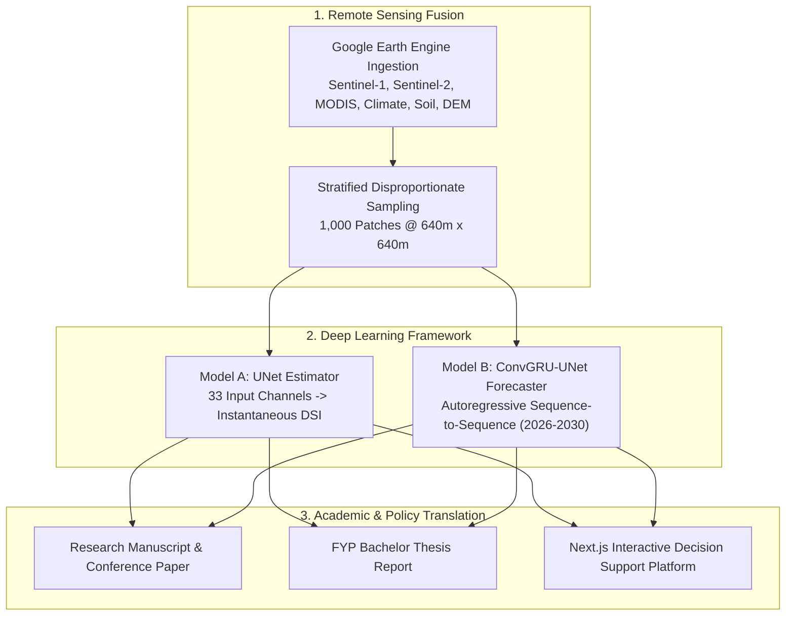

# Research, Thesis Documentation & Academic Publications

This directory contains the academic research manuscripts, Final Year Project (FYP) thesis drafts, technical guidelines, executive summaries, and presentation assets for the **Spatio-Temporal AI Framework for Sindh Desertification Risk Prediction and Forecasting (STAFDRS)**.

---

## 📄 Core Documents & Manuscript Directory

| Document Name | Format | Description / Scope |
| :--- | :---: | :--- |
| **`STAFDRS-updated.pdf`** | PDF | Comprehensive technical report and updated research monograph detailing data ingestion, model architectures, evaluation benchmarks, and policy findings. |
| **`STAFDRS.pdf`** | PDF | Initial project proposal and formal specification document outlining problem scope and methodological approach. |
| **`research_paper_summary.docx`** | DOCX | Executive manuscript summary highlighting the research novelty, methodology, experimental results, and key findings. |
| **`research_paper_rough.docx`** | DOCX | Full academic research paper draft prepared for peer-reviewed journal / conference submission. |
| **`thesis_writing/`** | Directory | Departmental thesis guidelines, abstract specifications, and formatting templates. |

---

## 🎓 Academic Abstract & Research Novelty

> **Title:** Spatio-Temporal AI Framework for Sindh Desertification Risk Prediction and Forecasting (STAFDRS)  
> **Domain:** Geospatial Artificial Intelligence, Environmental Remote Sensing, Climate Change Adaptation  

### Abstract Overview
Land degradation and desertification represent critical threats to the environmental stability, food security, and socio-economic resilience of Sindh, Pakistan. Traditional monitoring frameworks like the Mediterranean Desertification and Land Use (MEDALUS) model depend on static, labor-intensive spatial overlays that lack real-time predictive capacity and fail to capture non-linear temporal dynamics.

This research presents **STAFDRS**, an integrated deep learning framework that operationalizes satellite remote sensing for predictive land degradation governance:
1. **Multi-Sensor Data Fusion:** Harmonizes 38 distinct satellite and environmental variables (Sentinel-1 SAR, Sentinel-2 MSI, MODIS thermal/vegetation, CHIRPS rainfall, TerraClimate, SoilGrids, SRTM topography, and VIIRS nightlights) over a 10-year observation baseline ($2016 \to 2026$) covering 1,000 stratified patches across Sindh.
2. **Current Sensitivity Estimation (Model A):** Implements a customized Spatio-Temporal UNet utilizing Group Normalization, SiLU activations, and an exponentially tiered DSI-weighted compound loss to resolve extreme vulnerability zones ($DSI \ge 0.6$).
3. **Multi-Year Recurrent Forecasting (Model B):** Formulates an autoregressive Sequence-to-Sequence model combining shared spatial CNN encoders with Convolutional Gated Recurrent Units (ConvGRU) to generate multi-year quarterly spatial projections ($2026 \to 2030$) while restricting temporal error drift.
4. **Generalization Rigor:** Validated across an independent, spatially and temporally disjoint test set of 500 patches spanning January 2024 to February 2026.
5. **Decision Support & Generative AI:** Integrated into a production-grade Next.js geospatial dashboard backed by FastAPI and Google Gemini for streaming multimodal conversational retrieval and automated policy brief generation.

---

## 🏛️ Methodological Highlights & Theoretical Grounding

---

## 📑 Departmental Guidelines & Thesis Templates (`thesis_writing/`)

- **`FYP Thesis Template and Guidelines CSE.docx`:** Standard academic thesis formatting guidelines from the Department of Computer Science & Software Engineering.
- **`FYP Thesis Guidelines for Abstract.docx`:** Specific criteria for abstract structuring, problem formulation, contribution claims, and keyword indexing.
- **`graphviz - Copy.png`:** High-resolution vector diagram representing the conceptual entity relationships and pipeline dataflow.
